<!-- Header -->

  

  
  

  

### `$ whoami`

  

I build trading infrastructure where the budget is counted in **nanoseconds**: order books, matching engines, gateways, and the queues and allocators underneath them. Professionally a C++ engineer, increasingly writing **Rust**. I like designs you can measure, so most of my repos ship with a benchmark, a profiler run, or a fault simulator next to the code.

  

  

  

### ⚡ Exchanges & trading infrastructure

<table>
<tr>
<td width="50%" valign="top">

<h3><a href="https://github.com/breakbadsp/modern_exchng_cpp">modern_exchng_cpp</a></h3>
`C++26` `epoll` `io_uring` `SPSC` `contracts`

A complete exchange: limit order book with price-time (FIFO) matching, a busy-polling gateway with **epoll and io_uring** backends, one **pinned engine thread per core** fed by SPSC rings, and a load generator. Fixed-capacity pools, no heap allocation on the hot path. Replicated across a cluster with libvsr, plus a browser **fault-tolerance game** to crash replicas and watch it survive.

**2.39M ops/s** · p99 **47 µs** end-to-end over TCP ([docs](https://github.com/breakbadsp/modern_exchng_cpp/blob/master/docs/performance.md))

</td>
<td width="50%" valign="top">

<h3><a href="https://github.com/breakbadsp/libvsr">libvsr</a></h3>
`C++23` `consensus` `deterministic simulation`

A generic **Viewstamped Replication** library inspired by TigerBeetle. Keeps a deterministic state machine identical across machines and survives crashes and power loss. The app supplies three functions (execute, snapshot, restore); libvsr replicates opaque bytes.

Verified by a **seeded simulator** that runs the production replica code over a fake network, disk and clock, injecting loss, delay, reordering and storage faults.

</td>
</tr>
<tr>
<td width="50%" valign="top">

<h3><a href="https://github.com/breakbadsp/spx">spx</a></h3>
`Rust` `cargo workspace`

A low-latency stock exchange in Rust: separate crates for the **matching engine**, order server, message types and a concurrency lib. Price-time matching with a per-symbol order book.

</td>
<td width="50%" valign="top">

<h3><a href="https://github.com/breakbadsp/MktDataAggregator">MktDataAggregator</a></h3>
`C++` `mmap` `k-way merge`

Merges ~10,000 per-symbol market-data files (100+ GB) into one time-ordered tape for backtesting. **K-way merge** over memory-mapped, chunked readers, built to stay under OS file-handle limits.

</td>
</tr>
</table>

### 🧵 Concurrency & systems primitives

  

| Project | What it is | Under the hood |
|:--|:--|:--|
| **[sp](https://github.com/breakbadsp/sp)** | The STL, rebuilt from scratch in modern C++ | lock-free MPSC queue, spinlock, latch, object & memory pools, open-addressing hash set, `shared_ptr` |
| **[spmalloc](https://github.com/breakbadsp/spmalloc)** | A `malloc`/`free`/`realloc` of my own | `sbrk` heap, block splitting & coalescing, `LD_PRELOAD`-able `.so` |
| **[1brc](https://github.com/breakbadsp/1brc)** | One Billion Row Challenge in C++ | `mmap` zero-copy input, core-pinned threads, per-thread FNV-1a open-addressing maps |
| **[rust_mpsc_queue](https://github.com/breakbadsp/rust_mpsc_queue)** · **[rust_mpmc_queue](https://github.com/breakbadsp/rust_mpmc_queue)** | Channels in Rust, built to study MPSC vs MPMC contention | `Arc<Mutex>` + `Condvar`, receiver-side batching |
| **[ping_pong_server](https://github.com/breakbadsp/ping_pong_server)** | Minimal Rust TCP round-trip server | `std::net`, buffered I/O |

### 🔭 Observability

<table>
<tr>
<td valign="top">

<h3><a href="https://github.com/breakbadsp/triangulator">triangulator</a></h3>
`C++23` `TypeScript` `/proc` `UDP` `SQLite`

See what **every thread** of a Linux process is doing, live or recorded: CPU demand, scheduler wait channels, memory, I/O and sockets. A C++ sampler reads `/proc` and streams UDP to a collector that stores SQLite day files and serves a dashboard with **time-travel replay**. Rewriting the collector from Python to C++ cut it from **32.2% → 4.08%** of a core at 1,000 threads, and dashboard p95 from **78.8 ms → 0.89 ms**.

</td>
</tr>
</table>

  

---

### 🛠️ Toolbox

  

  <code>lock-free queues</code> · <code>cache-line layout</code> · <code>CPU pinning</code> · <code>epoll / io_uring</code> · <code>mmap</code> · <code>custom allocators</code> · <code>perf</code> · <code>ASan</code> · <code>UBSan</code> · <code>deterministic simulation</code>

### 📈 Activity

  

  

  

